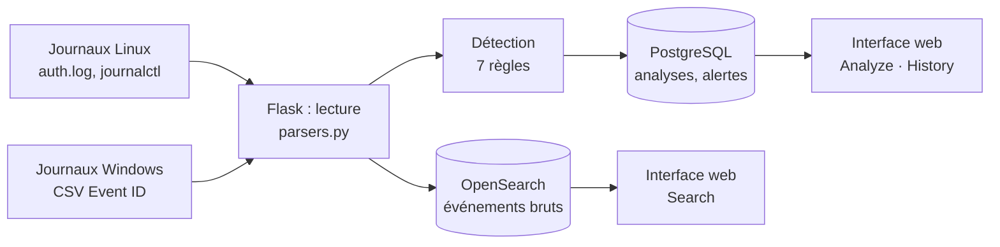
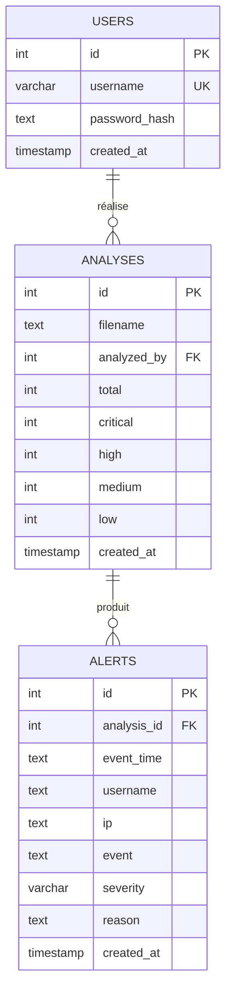

<p align="center">
  
</p>

<h1 align="center">ASSAS</h1>
<p align="center"><b>Analyse, Surveillance et Supervision des Accès Suspects</b><br>
Application web de gestion et d'analyse des journaux de sécurité Linux et Windows</p>

<p align="center">
Mini-projet · Groupe 5 · Module Cybersécurité Opérations – Analyse réseau &amp; SOC<br>
Faculté Polydisciplinaire de Larache · Université Abdelmalek Essaâdi · 2026–2027<br>
Aya Talidi (SMI0146/24) · Salma Chakir (SMI0159/24) · Encadré par Pr. Hkhankhour
</p>

---

## Sommaire

1. [Présentation](#1-présentation)
2. [Fonctionnalités](#2-fonctionnalités)
3. [Architecture](#3-architecture)
4. [Prérequis](#4-prérequis)
5. [Installation](#5-installation)
6. [Lancement](#6-lancement)
7. [Utilisation](#7-utilisation)
8. [Formats de journaux acceptés](#8-formats-de-journaux-acceptés)
9. [Règles de détection](#9-règles-de-détection)
10. [Base de données](#10-base-de-données)
11. [Sécurité](#11-sécurité)
12. [Tests](#12-tests)
13. [Structure du projet](#13-structure-du-projet)
14. [Dépannage](#14-dépannage)

---

## 1. Présentation

ASSAS centralise les journaux de sécurité de machines Linux et Windows, détecte automatiquement les comportements suspects (force brute, compte compromis, backdoor…) et les présente dans un tableau de bord web réservé à l'administrateur.

Le nom vient du *3assas*, le gardien qui veillait la nuit sur le quartier au Maroc.

## 2. Fonctionnalités

| Fonctionnalité | Où |
| --- | --- |
| Import de journaux Linux et Windows | Page **Analyze** |
| Centralisation de tous les événements | OpenSearch (index `assas-logs`) |
| Recherche par utilisateur, IP, date, type, statut, texte | Page **Search** |
| Détection des échecs d'authentification et des connexions répétitives | `detection.py` (7 règles) |
| Graphiques statistiques | Tableau de bord de la page **Analyze** |
| Historique des analyses et des alertes | Page **History** (PostgreSQL) |
| Rapport des alertes | Bouton **Download CSV report** (page **Analyze**) et lien **CSV** (page **History**) |
| Accès réservé à l'administrateur | Page **Login** (mots de passe hachés, protection CSRF, blocage après 5 échecs) |

## 3. Architecture



| Composant | Technologie |
| --- | --- |
| Backend | Python 3, Flask, pandas |
| Authentification | Flask-Login, mots de passe hachés (Werkzeug), jeton CSRF |
| Stockage des événements | OpenSearch 2.17 |
| Stockage applicatif | PostgreSQL 16 |
| Graphiques | Chart.js (inclus dans `static/`, fonctionne sans Internet) |
| Conteneurs | Docker Compose |

## 4. Prérequis

| Outil | Version conseillée | Vérification |
| --- | --- | --- |
| Python | 3.10 ou plus | `python3 --version` |
| Docker Desktop | récent, avec 4 Go de RAM | `docker --version` |
| Git | récent | `git --version` |
| Espace disque libre | 5 Go au moins | |

## 5. Installation

```bash
# 1. Récupérer le projet
git clone https://github.com/shamisaaya-jpg/ASSAS.git
cd ASSAS

# 2. Environnement Python
python3 -m venv .venv
source .venv/bin/activate          # Windows : .venv\Scripts\activate
pip install -r requirements.txt

# 3. Fichier de configuration (puis modifier les valeurs dans .env)
cp .env.example .env
python -c "import secrets; print(secrets.token_hex(32))"   # valeur pour SECRET_KEY

# 4. Lancer PostgreSQL et OpenSearch (Docker Desktop doit être ouvert)
docker compose up -d
docker ps                          # assas-postgres et assas-opensearch : Up
curl http://localhost:9200         # OpenSearch répond en JSON

# 5. Créer le compte administrateur (mot de passe : 8 caractères au moins)
python create_admin.py
```

| Variable de `.env` | Rôle |
| --- | --- |
| `SECRET_KEY` | Clé de signature des sessions (longue chaîne aléatoire) |
| `POSTGRES_PASSWORD` | Mot de passe de PostgreSQL, utilisé par Docker à la création de la base |
| `DATABASE_URL` | Connexion à PostgreSQL (même mot de passe que `POSTGRES_PASSWORD`) |
| `OPENSEARCH_URL` | Adresse d'OpenSearch (`http://localhost:9200`) |
| `SESSION_COOKIE_SECURE` | `1` seulement si ASSAS est servi en HTTPS |
| `FLASK_DEBUG` | Laisser à `0` |

Le fichier `.env` n'est jamais envoyé sur GitHub (il est dans `.gitignore`).

Les tables PostgreSQL sont créées automatiquement au premier lancement. Le script `database/schema.sql` permet aussi de les créer à la main.

## 6. Lancement

```bash
source .venv/bin/activate
docker compose up -d
python app.py
```

Puis ouvrir **http://127.0.0.1:5001** et se connecter avec le compte administrateur.

Pour arrêter : `Ctrl + C` dans le terminal, puis `docker compose stop`.

## 7. Utilisation

### Analyser un fichier

1. Page **Analyze** → **Choose File** → choisir un journal (par exemple `sample_logs/demo_attack.log`).
2. Cliquer sur **Analyze logs**.
3. ASSAS affiche :
   - le nombre d'événements stockés dans OpenSearch ;
   - les compteurs d'alertes par gravité ;
   - le tableau de bord : chronologie, attaquant principal, gravité, IP et comptes les plus ciblés ;
   - la liste des alertes, exportable en CSV.

### Rechercher dans les journaux

Page **Search** : filtrer par utilisateur, adresse IP, type d'événement, statut, période ou texte du message.
Exemple : `User = root`, `Status = failed`.

### Consulter l'historique

Page **History** : analyses passées et alertes enregistrées, filtrables par gravité. Le lien **CSV** de chaque analyse télécharge son rapport.

### Fichiers de démonstration

| Fichier | Système | Contenu | Résultat attendu |
| --- | --- | --- | --- |
| `sample_logs/auth_test.log` | Linux | 7 lignes de test | 3 alertes |
| `sample_logs/demo_attack.log` | Linux | Une journée, attaque à 22 h (60 tentatives puis connexion root) | 140 événements, 9 alertes |
| `sample_logs/windows_security.csv` | Windows | Force brute, connexion Administrator, compte `backdoor` ajouté aux administrateurs | 71 événements, 8 alertes |

Les deux derniers sont générés par `make_demo_log.py` et `make_demo_windows.py`. Ce sont des journaux simulés au format réel.

### Exporter de vrais journaux

| Système | Commande |
| --- | --- |
| Linux (Ubuntu, Kali) | `sudo journalctl _COMM=sshd _COMM=sudo -o short-iso --since today > vrais_logs.log` |
| Windows | PowerShell en administrateur : `powershell -ExecutionPolicy Bypass -File .\export_windows_logs.ps1` |

## 8. Formats de journaux acceptés

| Extension | Format |
| --- | --- |
| `.log`, `.txt` | Journal d'authentification Linux (`auth.log` ou `journalctl -o short-iso`) |
| `.csv` | Export Windows (script PowerShell ou Observateur d'événements), ou CSV avec les colonnes `timestamp, user, ip, event, status` |
| `.json` | Liste d'événements avec les mêmes champs |

Taille maximale : 10 Mo par fichier.

## 9. Règles de détection

| # | Règle | Condition | Gravité |
| --- | --- | --- | --- |
| 1 | Force brute | ≥ 5 échecs depuis une même IP en 5 minutes | HIGH |
| 2 | Compte compromis | Connexion réussie depuis cette IP après les échecs | CRITICAL |
| 3 | Password spraying | Une IP essaie ≥ 3 comptes différents | MEDIUM |
| 4 | Abus de sudo | ≥ 3 sudo échoués pour un utilisateur en 5 minutes | MEDIUM |
| 5 | Échecs isolés | Échecs sous les seuils | LOW |
| 6 | Niveau du journal | `critical` / `fatal` → CRITICAL, `error` → MEDIUM | Variable |
| 7 | Modification de comptes (Windows) | Compte créé (4720) : CRITICAL s'il suit une compromission (backdoor), sinon MEDIUM ; ajout aux Administrators (4728/4732) : HIGH, autre groupe : MEDIUM ; compte verrouillé (4740) ou supprimé (4726) : MEDIUM | CRITICAL / HIGH / MEDIUM |

## 10. Base de données

### Modèle PostgreSQL



| Fichier | Rôle |
| --- | --- |
| `database/schema.sql` | Création des tables et des index |
| `database/queries.sql` | Requêtes utiles (historique, alertes critiques, top IP…) |
| `database/reset.sql` | Remise à zéro avant une démonstration (garde les comptes) |
| `database/opensearch_mapping.json` | Structure de l'index OpenSearch `assas-logs` |

```bash
# Créer les tables à la main
docker exec -i assas-postgres psql -U assas -d assas < database/schema.sql

# Lancer les requêtes utiles
docker exec -i assas-postgres psql -U assas -d assas < database/queries.sql

# Remise à zéro avant une démo
docker exec -i assas-postgres psql -U assas -d assas < database/reset.sql
curl -X DELETE http://localhost:9200/assas-logs
```

## 11. Sécurité

| Mesure | Détail |
| --- | --- |
| Mots de passe | Hachés avec Werkzeug, jamais stockés en clair |
| Formulaires | Jeton CSRF sur chaque formulaire |
| Connexion | Blocage après 5 échecs en 15 minutes depuis une même IP |
| Cookies de session | `HttpOnly`, `SameSite=Lax`, `Secure` si `SESSION_COOKIE_SECURE=1` |
| Mode debug | Désactivé par défaut (`FLASK_DEBUG=0`) : le débogueur Werkzeug permet d'exécuter du code |
| Ports Docker | PostgreSQL et OpenSearch écoutent sur `127.0.0.1` uniquement |
| `SECRET_KEY` | Sans valeur dans `.env`, ASSAS génère une clé aléatoire et les sessions se ferment à chaque redémarrage |
| `POSTGRES_PASSWORD` | Pris en compte seulement à la création du volume. Pour le changer ensuite : `ALTER USER assas PASSWORD '...'`, puis mettre à jour `DATABASE_URL` |

Tous les analystes connectés partagent l'historique et les rapports : ASSAS est un outil pour une seule équipe.

## 12. Tests

```bash
pip install -r requirements-dev.txt
pytest
```

Les tests web ont besoin de PostgreSQL : s'il n'est pas lancé, ils sont ignorés.

## 13. Structure du projet

```
ASSAS/
├── app.py                    # Application Flask : pages, connexion, import, recherche
├── parsers.py                # Lecture des journaux Linux, CSV et JSON
├── windows_parser.py         # Lecture des événements Windows
├── detection.py              # Les 7 règles de détection
├── charts.py                 # Données du tableau de bord
├── reports.py                # Résumé par gravité et export CSV
├── db.py                     # Accès à PostgreSQL
├── search_store.py           # Indexation et recherche dans OpenSearch
├── create_admin.py           # Création d'un compte administrateur
├── docker-compose.yml        # Conteneurs PostgreSQL et OpenSearch
├── .env.example              # Modèle du fichier de configuration .env
├── requirements.txt          # Bibliothèques Python
├── requirements-dev.txt      # Bibliothèques pour les tests et make_logo.py
├── database/                 # Modèle et scripts SQL
├── templates/                # Pages HTML
├── static/                   # Logo, icônes, Chart.js
├── sample_logs/              # Journaux de démonstration
├── tests/                    # Tests automatiques (pytest)
├── make_demo_log.py          # Génère demo_attack.log
├── make_demo_windows.py      # Génère windows_security.csv
├── make_logo.py              # Génère owl.png et favicon.png à partir de l'image du hibou
└── export_windows_logs.ps1   # Export des journaux d'un poste Windows
```

## 14. Dépannage

| Problème | Solution |
| --- | --- |
| `Too many failed attempts` à la connexion | 5 mots de passe faux en 15 minutes : attendre, ou redémarrer `python app.py` |
| `Database unavailable` sur la page de connexion | Ouvrir Docker Desktop, puis `docker compose up -d` |
| `Address already in use` / port 5001 occupé | Une ancienne instance tourne : `kill $(lsof -t -i :5001)` |
| Erreur 403 sur le port 5000 (macOS) | Le port 5000 est pris par AirPlay : ASSAS utilise 5001 |
| `OpenSearch is not reachable` | `docker ps` ; attendre 30 s après le démarrage, puis `curl http://localhost:9200` |
| `read-only file system` dans Docker | Libérer de l'espace disque, puis redémarrer Docker Desktop |
| Les graphiques ne s'affichent pas | Vérifier que `static/chart.umd.min.js` existe |
| La recherche affiche trop de résultats | Le même fichier a été analysé plusieurs fois : remise à zéro (section 10) |
